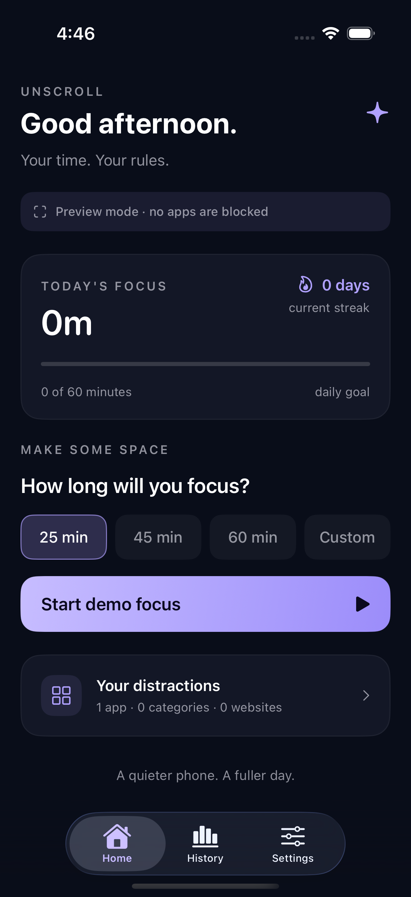
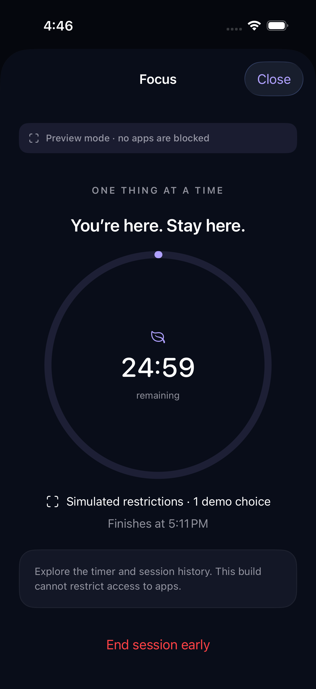
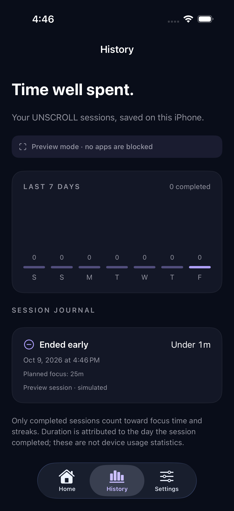

# UNSCROLL

**Your time. Your rules.** A native iPhone focus app built with SwiftUI and Apple's Screen Time frameworks. Free, open source, and local: no backend, analytics, advertisements, subscriptions, third-party packages, or runtime service fees.

**Preview mode simulates permission, app selection, scheduling, and blocking. It does not restrict access to real applications.** The timer, saved sessions, history, and preferences work in Preview.

## Current status

The MVP UI and session lifecycle are implemented. Preview has been built and tested in the simulator and installed on a physical iPhone. Real Screen Time services and the DeviceActivity Monitor extension are implemented and preserved, but genuine blocking remains unverified on a correctly provisioned physical device.

Development is paused pending access to eligible Apple Developer Program signing. Contributions that improve reliability, accessibility, documentation, and device validation are welcome. There is no promised release date, hosted service, or App Store listing.

| Mode | What works | Signing |
| --- | --- | --- |
| Preview simulator | UI, demo sessions, persistence, history, settings | No Apple Account or paid membership required |
| Preview iPhone | Same simulated behavior; no real app blocking | Free Personal Team development signing |
| Live iPhone | Real Screen Time integration implemented; enforcement not yet validated | Apple Developer Program team with Family Controls development profiles for app and monitor |

## Screenshots

Actual Preview UI test captures with illustrative demo choices and a simulated session:

| Home | Focus | History |
| --- | --- | --- |
|  |  |  |

## Requirements

- macOS and Xcode with Swift 6 support and an iOS 26.4 or newer SDK. The source references APIs added in iOS 26.4; older SDKs are not supported by this release.
- Tested toolchain: **Xcode 27.0 (27A266a), Swift 6.4**. Initial compiler checks also used Xcode 26.6 / Swift 6.3.3.
- Deployment target: **iOS 17 or newer**. Running on an iOS 17 device has not yet been validated.
- Install iOS platform support and a simulator runtime through Xcode's Settings → Components. No external packages, credentials, API keys, or server setup are needed for simulator Preview.

## Local development and Preview

Clone or download this repository, open a terminal at the project root, and open `UNSCROLL.xcodeproj` in Xcode.

1. Select **UNSCROLL Preview** and an installed iPhone simulator.
2. Choose **Product → Run**.
3. In onboarding, tap **Simulate permission**, choose at least one demo distraction, save, and tap **Find your focus**.
4. Start a demo session and explore Home, History, and Settings. Demo choices do not represent installed apps. Preview data is stored separately from Live data.

Build the simulator app from the project root:

```sh
xcodebuild -project UNSCROLL.xcodeproj -scheme 'UNSCROLL Preview' \
  -destination 'generic/platform=iOS Simulator' \
  -derivedDataPath .build-xcode CODE_SIGNING_ALLOWED=NO build
```

Run the core tests:

```sh
swift test
```

For hosted core and UI tests, select **UNSCROLL Preview**, choose an iPhone simulator, and use **Product → Test**. Use `xcrun simctl list devices available` to find installed runtimes. Full validation details and reproducible commands are in [VALIDATION.md](VALIDATION.md).

### Preview on your own iPhone

1. Add your Apple Account in Xcode → Settings → Apple Accounts. Do not put account credentials in project files.
2. Copy the generic local settings template:

```sh
cp Config/Local.xcconfig.example Config/Local.xcconfig
```

3. Edit `Config/Local.xcconfig` with your team ID and unique bundle/group identifiers. This file is ignored. For a Preview-only team override, `Config/Preview.local.xcconfig` is also supported and ignored.
4. Connect and unlock your iPhone, trust the Mac if prompted, and enable Developer Mode in iPhone Settings → Privacy & Security if required.
5. Select **UNSCROLL Preview → your iPhone** and **Product → Run** with automatic signing.

Preview requests neither Family Controls nor App Groups. Free development profiles expire seven days after issuance and require rebuilding/reinstalling with Xcode; do not delete the app just to renew signing. See [Apple's free account limitations](https://developer.apple.com/help/account/basics/about-your-developer-account) and the [manual device checklist](Docs/PHYSICAL_IPHONE_TEST.md).

## Real Screen Time limitations and signing

**A free Personal Team cannot provision Family Controls (Development).** Our automatic signing attempt failed for both the app and DeviceActivity Monitor with Xcode's explicit Personal Team capability rejection. This is an Apple signing requirement; removing the entitlement or using an unsigned build does not enable genuine blocking.

Apple's current [capability matrix](https://developer.apple.com/help/account/reference/supported-capabilities-ios) lists **App Groups as available to free Apple Developer accounts**, but Family Controls development requires Apple Developer Program membership. The existing Preview profiles lack both capabilities. App Groups support alone cannot unlock Live blocking.

UNSCROLL's MIT license and features remain free. Apple's developer membership is separate; nothing in this project enrolls you, purchases membership, or enables paid services.

To resume Live device validation with an eligible team:

1. Set your own signing team, unique bundle ID, and shared group in ignored `Config/Local.xcconfig`.
2. Register explicit IDs for the app and `<UNSCROLL_BUNDLE_ID>.monitor`. Enable Family Controls development for both IDs, and assign the same registered App Group to both.
3. Select **UNSCROLL Live**. Both targets use `Config/Live.entitlements`, requesting `com.apple.developer.family-controls = true` and `com.apple.security.application-groups = [$(UNSCROLL_APP_GROUP)]`.
4. Generate valid development profiles for both targets, covering the test iPhone. Verify profiles and signed entitlements before installation. A development certificate alone does not establish capability access.
5. Use the read-only provisioning checker with your local profiles:

```sh
python3 Scripts/check_provisioning.py \
  --app-profile path/to/App.mobileprovision \
  --monitor-profile path/to/Monitor.mobileprovision \
  --bundle-id com.yourname.unscroll \
  --app-group group.com.yourname.unscroll
```

6. On your own physical device, authorize individual Screen Time access, select a harmless test app using Apple's real picker, start focus, and manually verify its system shield. End early and verify access returns. Follow the acceptance checklist below.

**Preview and Live use the same default bundle identifier. Installing Live with that identifier replaces Preview.** Use distinct bundle identifiers in local configuration when you need both installations; never remove existing app data unnecessarily.

For TestFlight or App Store distribution, the Account Holder must separately request Family Controls distribution approval for the app and relevant Screen Time extension, then regenerate profiles. Development access does not establish distribution approval. See [Configuring Family Controls](https://developer.apple.com/documentation/xcode/configuring-family-controls), [Configuring App Groups](https://developer.apple.com/documentation/xcode/configuring-app-groups), and [Requesting the Family Controls entitlement](https://developer.apple.com/documentation/familycontrols/requesting-the-family-controls-entitlement).

The monitor remains embedded in both schemes. Preview never invokes live authorization/shield services or registers DeviceActivity schedules. Simulator runs and SwiftUI previews always use mock services, even with the Live scheme. A physical Live build with missing shared storage presents a configuration error.

## What is implemented

- Four-step onboarding: welcome, local privacy, permission, and selection; permission can be deferred while exploring.
- Individual authorization, denial/restriction/unavailability errors, authorization change subscription, foreground rechecks, and safe session termination on lost authorization.
- Real private app/category/web-domain picker; Codable selections in App Group preferences; exact token counts without decoding opaque identifiers.
- ManagedSettings application, application-category, web-domain, and web-domain-category shields, isolated in the named `unscroll.focus` store.
- Focus sessions at 25/45/60 minutes and a custom 15–720 minutes; configurable default duration; confirmation for early stop.
- Idle (no active record), preparing, active, completed, ended-early, and failed lifecycle states; persisted UUIDs and absolute timestamps.
- DeviceActivity Monitor extension with one-shot UTC intervals, deadline and UUID checks, durable completion records, and safe foreground recovery.
- Home dashboard, progress-ring focus screen, editable selection, session journal, seven-day bar history, streaks, completed session count, and daily goal.
- Dark/light/system appearance, privacy/about pages, permission retry, iPhone Settings link, and destructive-history confirmation.
- Dynamic Type layouts, VoiceOver labels for chart/timer/progress/selection, reduced-motion-aware selection/onboarding animations, and native system controls.
- Twenty-four focused lifecycle, callback, persistence, statistics, and restriction-ownership tests (see `Tests/CoreTests`).

## Simulated and deferred

Preview permission, illustrative choices, scheduling, and shields are simulated. Its local timer and history are functional and always labeled. No seeded or invented statistics are presented.

Recurring schedule creation is **deferred**: SchedulingService currently schedules expiration of focus sessions only. The focus store and monitor prefix are isolated so independent stores, if added later, are preserved. Tests verify clearing focus does not clear an independent restriction owner. No recurring schedule UI is implied.

DeviceActivity usage reporting, per-app/device screen-time statistics, custom shield artwork/actions, notifications, cloud syncing, parental monitoring, and all account/payment features are outside this MVP. The built-in Apple shield is used. SwiftData is intentionally unnecessary for this small journal: shared atomic Codable files provide an explicit lock for app/extension writes; UserDefaults stores settings and selections.

## Expiration and recovery design

A record in `preparing` is committed **before** requesting a monitor or applying a shield. Registration must succeed before shielding. Shield writes and transition to `active` occur under the same cross-process file lock used by the extension. Failure rolls back focus shields and that session's monitor. A preparing record found on relaunch is failed and cleared.

One bounded named store avoids accumulating names against Apple's store limit. Focus overlap is rejected. Every DeviceActivity activity name carries a unique session UUID. The extension checks that UUID, pending state, and absolute end date inside the shared transaction before clearing the focus store. Delayed, early, duplicate, or cancelled callbacks cannot clear a newer session. The extension never reapplies shields on interval start. Expiration records use the planned deadline, not a delayed callback's arrival time.

On foreground activation and every second while an active session is visible, the manager reconciles authorization, expiration, and the presence of its monitor. The visible countdown derives from dates, not a decremented counter. A foreground timer is only a refresh mechanism. UTC schedule components keep the deadline independent of timezone travel and daylight-saving changes; history uses the current local calendar. Changing the actual system clock can affect wall-clock deadlines, so this is voluntary focus rather than tamper-resistant supervision.

App and extension journal writes are serialized using an advisory POSIX lock and atomic file replacement. Finished records are immutable to stale callbacks. Corrupt storage is reported and preserved rather than replaced with fake empty history. App startup removes orphaned focus monitors and clears the owned focus store if journal recovery fails; independent stores remain untouched.

## Known iOS limitations and device validation

Apple's monitor callbacks are system scheduled and can be delayed. **Exact-second automatic unblock is not guaranteed**, especially when the app is terminated, the device restarts, or the system cannot deliver a callback. Reopening UNSCROLL clears expired sessions; the early-stop action clears immediately on a functioning authorized build. If the app cannot open shared storage, live startup clears its focus store and presents an error. Screen Time authorization can also be revoked in iPhone Settings. Do not promise unattended exact-boundary release.

ManagedSettings setters are synchronous and do not throw. UNSCROLL verifies the written shield configuration and permission before publishing an active session. Apple provides no enforcement acknowledgment proving that a selected app presented a shield. The UI says **Shield configured**; actual system enforcement must be checked on a provisioned physical device. Web/category behavior follows Apple's supported policy, and category selections may overlap app selections; the counts describe selected tokens, not a deduplicated count of installed apps.

Live acceptance must be checked on a physical iPhone:

- Permission approve/deny/revoke/restrict, and retry from Settings.
- App-only, category-only, website-only, empty selection, and cancellation of the picker.
- Early stop; background end with the app suspended and terminated; reopen after expiration/reboot.
- Two successive sessions with delayed/duplicate callbacks from the first.
- 15-minute, midnight-crossing, daylight-saving, and timezone-change sessions.
- Smaller iPhone layout, largest accessibility text sizes, VoiceOver, light/dark contrast, and Reduce Motion.

Automatic Live provisioning was attempted with a free Personal Team and rejected for both the app and monitor because Family Controls (Development) is unsupported. No valid Live binary was installed. Core test results and compiler checks are recorded in `VALIDATION.md`; the Preview device checklist is in `Docs/PHYSICAL_IPHONE_TEST.md`. A successful unsigned compiler build does not validate provisioning or physical shielding.

## Source map

`App/Bootstrap` owns dependency injection and app lifecycle. `App/Features` contains native feature screens; AppModel and FocusSessionManager are their observable view-model layer. `App/DesignSystem` contains colors and controls. `App/Services` isolates real Apple calls and selection persistence. `Shared/Core` contains protocol seams, session models/repository, the focus state machine, monitor recovery, mocks, and statistics. `Monitor` is the DeviceActivity extension. `Config` contains the four build configurations, signing settings, and entitlements. `Tests/CoreTests` works with Swift Package Manager and the hosted Xcode test target. `Tests/UITests` verifies the complete preview onboarding, selection, focus, early-stop, history, and privacy flow and captures screenshots. `Scripts` contains the read-only provisioning check.

## Contributing and license

Read [CONTRIBUTING.md](CONTRIBUTING.md) for setup, checks, useful contribution areas, and privacy-safe bug reports. Small, focused pull requests are welcome. Do not include signing profiles, certificates, team IDs, account details, device identifiers, local paths, or personal session data.

Released under the [MIT License](LICENSE), copyright 2026 UNSCROLL contributors. The app has no paid core features. No GitHub Actions workflows or external services are configured.
